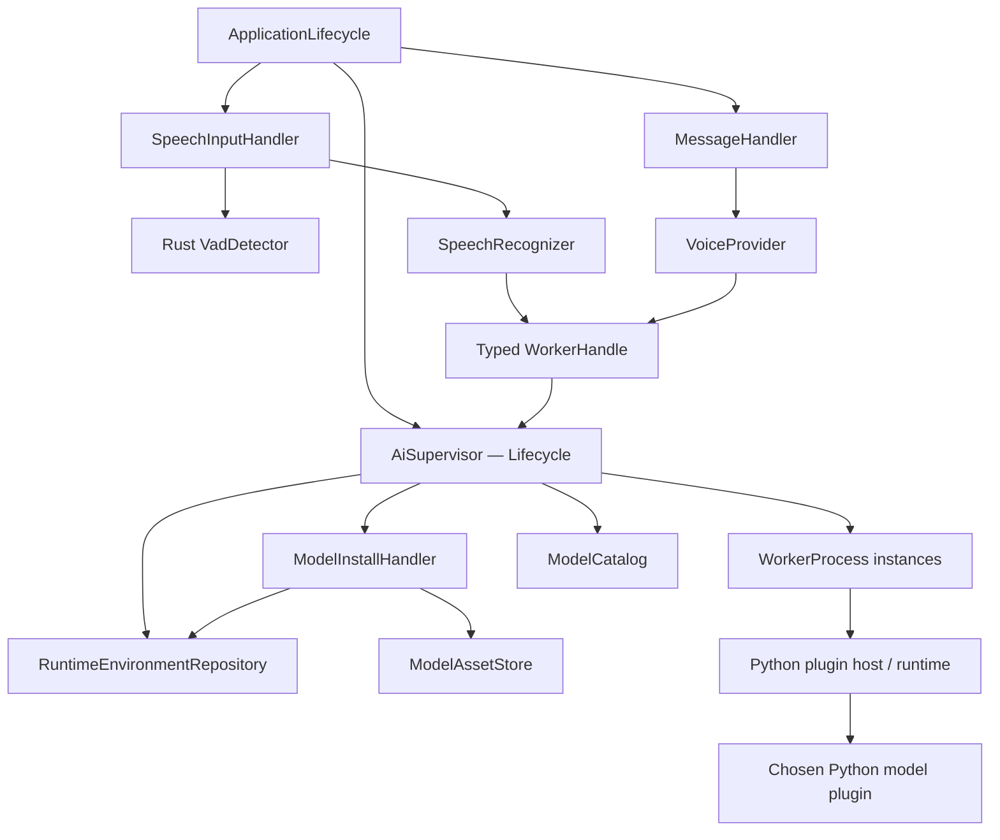
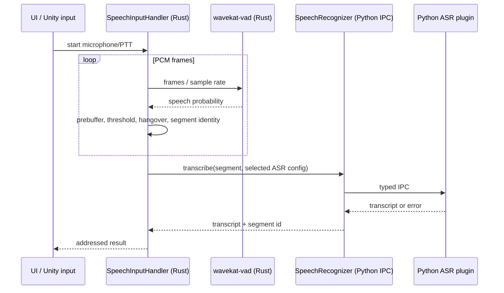

# NeuroMita — Rust Core + Python AI Plugin Runtime

**Статус:** частичная реализация первого вертикального среза; runtime/install parity не достигнута. 2026-11-03.  
**Основа:** `Atm4x/NeuroMita` Python `5f3d061`, `Atm4x/neuromita-rust` текущие интерфейсы и `future/root-primitives-and-client-contexts.md`; `wavekat/wavekat-vad` v0.1.17.  
**Связанные задачи:** #24 AI Runtime, #25 ASR, #26 TTS, #37 AI Hub, #42 Installables, #51 Hardware.  
**Ограничение области:** не заменяет текущую цель Generation/Request в `GOAL.md` и не объявляет Python parity достигнутой.

## 1. Архитектурное решение

1. Rust Core — **единственный владелец процессов**, пользовательских настроек, решений об активации, безопасного IPC-routing, аудиоввода и lifecycle. Python не создаёт второй независимый Supervisor.
2. Python — **платформа выполнения AI-плагинов**. Модели, их discovery, настройки, проверки, нестандартные установочные шаги и inference реализуются Python-кодом. Rust не содержит switch по ID F5/Silero/RVC/GigaAM.
3. Есть один общий versioned Python SDK и versioned IPC wire contract. Python `plugin.py` реализует этот SDK; Rust понимает **wire protocol**, а не Python-imports.
4. Наличие установленного плагина и готовность модели — разные вещи. Установка, компоновка окружений, запуск worker и загрузка weights имеют независимые состояния.
5. `shared` и `split` сохраняются. В активном выборе — один TTS и один ASR; установленных альтернатив может быть сколько угодно. Shared включает выбранные overlays нескольких сервисов; split — только overlays конкретного сервиса; RAG может включать embeddings и reranker. Новая custom topology сейчас не нужна.
6. Базовый VAD может исполняться **непосредственно в Rust**. Он является частью обработки аудиоввода, а не требует Python-процесса. Дорогой ASR/TTS inference остаётся Python plugin. Python VAD остаётся допустимой реализацией при доказанной необходимости, но не дублирует единственного владельца границ речи.
7. Профили голоса, конкретные модельные веса, Python-исходники и env packages **физически и логически разделены**.
8. Не вводить EventBus, capability registry или общий service locator. `Api / Lifecycle / Handler` остаются ролями, а не обязательными уровнями. Допускаются repositories, manifests, DTO и предметные интерфейсы.

## 2. Объектное владение и зависимости



**Важная оговорка:** диаграмма показывает владение и обращения; конкретный `WorkerHandle` — адресный типизированный клиент Supervisor, а не владелец процесса. Не создавать циклического владения `Supervisor ↔ API`. `VoiceProvider` уже существует в Rust; `SpeechRecognizer`, `AiSupervisor` и `ModelInstallHandler` — проектные роли/типы, не существующие реализации.

| Владелец | Обязанности | Не отвечает за |
| --- | --- | --- |
| `ApplicationLifecycle` | Композиция крупных компонент, порядок shutdown | pip, IPC framing, Silero inference |
| `AiSupervisor` | Запуск/остановка/контроль поколения child processes; topology; IPC correlation, deadlines, cancellation, activation | Настройки UI/модельный preprocessing, загрузка конкретных weights своими руками |
| `WorkerProcess` | Один OS PID, handshake, heartbeat, in-flight calls, generation, cleanup | Каталог плагинов, выбор персонажа |
| `ModelCatalog` | Идентичность, версии, доступные категории, достоверные результаты discovery | Запуск модели, authoritative installation state |
| `ModelInstallHandler` | Staging, установка, версионированные revisions, прогресс, verify, commit | Генерация текста/аудио |
| `RuntimeEnvironmentRepository` | Backend layers + выбранные overlay revisions, стабильное описание composition, install records | Одобрение сомнительных hooks, Python inference |
| `ModelAssetStore` | Хранилище весов, индекс/референс, хеш/тип/роль, safe paths, GC по ссылкам | Семантика голоса персонажа и настройки фразы |
| `SpeechInputHandler` | Mic/PTT, VAD, speech segments, gate, utterance identity и адресация результата | Python ASR model initialization |
| Python host/SDK | Плагин discover/probe/config schema/install-plan/initialize/infer/unload | Выбор активного персонажа, владельцы Rust-процессов, принятие Timeline-фактов |

### 2.1. Три процесса и один авторитет

- **Installer process:** временный child Python, загружает проверяемый plugin install hook, возвращает **план**, проверяет файлы и выполняет разрешённые hooks в staging. Не переиспользуется для inference.
- **Discovery/probe process:** короткоживущий Python subprocess для конкретного плагина. Не импортирует все модели одновременно, не устанавливает ничего, не загружает большую модель. Статический manifest доступен без Python.
- **Inference worker:** shared или split, загружает только выбранную композицию и активную модель; обслуживает `initialize`, `infer`, `unload` и `shutdown`.

Это **роли процессов**, а не требование держать три процесса постоянно. Python host — единый версионированный пакет/entrypoint, но не второй управляющий daemon, который автономно порождает и перезапускает собственные worker-процессы. Вложения процессов и полномочия остаются у Rust Supervisor.

## 3. Bootstrap: uv прежде Python

`uv` — самостоятельный бинарник и умеет устанавливать managed Python. **Не нужно предварительно скачивать Python специально ради установки uv.** Python версии фиксируются матрицей ABI совместимости плагинов, а не произвольным latest. Rust скачивает проверенный uv для платформы, проверяет hash/подпись согласно release policy и вызывает установку нужной версии CPython (`python-build-standalone`). Затем ставится **versioned `neuromita_ai_sdk` / plugin host** в изолированное служебное окружение. `uv pip` используется как package installer; требование отдельного `pip` внутри embeddable Python не закладываем.

Стадии UI: `Bootstrap absent → uv ready → Python ready → SDK ready → plugin catalog ready`. Базовый AI Hub должен быть доступен до установки Python: показывать bootstrap, ошибки и статические manifests. Полноценные dynamic probes, установка и inference включаются после bootstrap. Core, чат без локального Python и native VAD не блокируются установкой AI runtime.

Не фиксировать неподтверждённые размеры 30–40 МБ. Download size и installed size зависят от ОС, версии Python и состава optional runtime files. Не использовать официальный Windows embeddable ZIP как базовый произвольно расширяемый Python environment: у него отсутствует pip, а `._pth` изолирует пути; standalone CPython через uv более уместен для native wheels.

## 4. Дерево хранения

```text
AIData/
  bootstrap/
    uv/<version>/<platform>/...
    python/<python-version>/<platform>/...
    sdk/<api-version>/...                 # один известный Python SDK
  plugins/
    builtin/
      tts/silero-rvc/
        plugin.json                      # минимальная статическая карточка
        plugin.py                       # Python entrypoint (SDK contracts)
        install.py                      # optional install hooks / plan
        README.md
      tts/f5-tts/...
      asr/gigaam/...
    community/
      <publisher>/<plugin-id>/<version>/
        plugin.json
        plugin.py
        install.py
        README.md
  environments/
    bases/<backend>/<revision>/...      # PyTorch/ONNX family dependencies
    overlays/<plugin-id>/<revision>/... # model-specific packages
    compositions/<composition-id>.json  # authoritative resolved selection
    staging/<transaction-id>/...
  models/
    <plugin-id>/<model-id>/<revision>/   # weights, configs, tokenizer etc
  voices/
    <voice-profile-id>/
      voice.json                        # references to assets (not copies required)
      rvc/model.pth
      rvc/model.onnx
      rvc/model.index
      references/default.wav
      references/default.txt
  state/
    selected.json                       # active slots / revisions
    install-records.json
    permissions.json
  cache/
    downloads/
    wheels/
    temp-audio/
  logs/
```

`plugins/` содержит **код**, `models/` — веса/данные моделей, `voices/` — референсы и пользовательские профили, `environments/` — исполняемые зависимости, `bootstrap/` — базовый runtime. Plugin ID — стабильный namespaced ID, пользовательское имя не участвует в формировании доверенного пути. При изменении модели не модифицировать установленную ревизию: создавать staging и атомарно публиковать новую.

`plugin.json` должен быть минимальным без исполнения Python: `id`, `version`, `sdk_api`, `kind`, `entrypoint`, `publisher`, description и обязательная декларация trust/permissions. Это **не второй install plan**. Расширенные `settings`, модели, требования, asset plan, conditional rules и проверка доступны через Python SDK. Статические metadata сохраняются для отображения даже при сломанном Python-плагине. Нельзя сканировать произвольные `.py` из root и импортировать их без согласия пользователя.

## 5. Python SDK и IPC: контракты, не файлы как регламент

Предпочитаемые SDK-модули (в `bootstrap/sdk/` или поставляемом как package `neuromita_ai_sdk/`):

```text
neuromita_ai_sdk/
  contract.py         # PluginDescriptor, ModelKind, Plugin API
  settings.py         # typed schema, validation, dynamic options
  install.py          # Plan/Action/Requirement/Asset/Probe
  runtime.py          # load/unload/infer/stream protocols
  assets.py           # named paths, role requirements, hashes
  ipc.py              # versioned envelopes and error types
```

Плагин **импортирует** эти определения, но не копирует в каждую папку свой `contract.py`. Файлы `plugin.py`/`install.py` — локальные entrypoints, имена которых заданы manifest. В Python SDK удобно использовать протоколы/ABC/typed dataclasses, однако Rust получает только сериализуемые versioned DTO через IPC.

### 5.1. Предметные операции Python host

| Категория | Примеры вызовов | Ограничения |
| --- | --- | --- |
| Discovery | `describe`, `list_models`, `settings_schema` | Без импорта больших ML runtime и side effects |
| Installation | `probe_install`, `plan_install`, `verify_install`, `plan_remove` | План возвращает типизированные действия, не сериализуемые callable |
| Validation | `validate_config`, `validate_assets`, `resolve_requirements` | Отличать локальную ошибку конфига, неполную установку и аппаратную несовместимость |
| Runtime | `initialize`, `health`, `synthesize`/`transcribe`/`embed`, `cancel`, `unload` | Только в активном inference worker, с `worker_generation`/`request_id` |

`contract.py` не должен содержать старый `dict[str, Any]` без проверок для всех методов. Настройки плагина остаются расширяемыми JSON с namespaced keys, но schema, диапазоны, типы и допустимые enumerations валидируются SDK до IPC; Rust в AI Hub отображает типизированную schema и не имеет таблиц конкретных моделей.

### 5.2. Что делать с нестандартными install plans

Исходный Python `InstallAction` уже содержит `pip`, `download_http`, `call`, `call_async`, `uv_overrides`, `required_backend`, `environment_mutation`. `call` содержит Python function и **не может напрямую пересылаться по IPC**. В новой системе план передаёт только разрешённые типизированные действия: `InstallPackages`, `DownloadAsset`, `VerifyAsset`, `RunPluginHook(hook_id)`, `ProbeRuntime`, `PublishRevision`. Hook ID разрешается в Python installer-process **после explicit trust/permission approval** и работает только на staging-копии. Дополнительные платформенные нативные сборки требуют явно заявленных разрешений и изоляции; не давать произвольным плагинам без подтверждения выполнять команды в рабочем Python и модифицировать чужие environments.

Rust/uv отвечает за процессы и файловые транзакции; Python plugin рассчитывает requirements/план, знает особенности JIT/native path, Silero/torch/ONNX/RVC и проверяет применимость. `is_installed` возвращает аргументированную проверку, а не только факт существования папки: Python imports, version/ABI, model files, hashes, platform/device, optional dependencies, runtime smoke test. Различать `Discovered`, `Installed`, `EnvironmentReady`, `WorkerReady`, `ModelLoaded`, `InferenceReady` и причины ошибок.

### 5.3. Безопасность и отказоустойчивость

- Плагин — исполняемый сторонний код. Manifest сам по себе не sandbox; нужны отображение автора/источника/запрошенных прав, consent на hooks, обязательные path boundaries и предупреждение об отсутствии полноценной OS-песочницы.
- Один bounded message framing protocol (`length`, schema/version, request id, generation id, service, method, payload reference). Строки/metadata через IPC, крупные PCM/WAV через scoped files/handles или поток с backpressure, не Base64 гигантами.
- Timeout и cancel не гарантируют прерывание CUDA. `generation_id` запрещает принимать ответы от старого worker; timeout/error/failed initialization явно отображаются; скрытый retry внешних эффектов запрещён.
- Плагины не получают Timeline, ChatApi, SettingsLifecycle и не выбирают самостоятельно другую модель. Rust хранит active selection; Python получает уже разрешённый context/voice/config.

## 6. Shared и split без лишней сложности

`selected` хранит один `tts`, один `asr`, отдельно `rag:embeddings`, `rag:reranker`, `beats` (если включены). Все установленные альтернативы не должны попадать в `sys.path` автоматически. `runtime_composition` берёт базовые PyTorch/ONNX layers и выбранные overlays. При смене TTS в split пересоздаётся только TTS worker, ASR session не переинициализируется; в shared пересоздаётся общий worker с сохранением корректной selection. Нет model-per-process scheduler, пока не доказана потребность в одновременной работе двух TTS.

В shared возможен конфликт **между одновременно выбранными категориями**, а не между двумя альтернативными TTS. Обнаруживать конфликт до активации и возвращать явный статус; не полагаться только на порядок в `sys.path`. Не делать автоматический split/fallback без явного решения пользователя.

## 7. Speech, VAD и ASR



Умышленное разделение: Rust владеет устройством ввода, PTT/gate, сегментацией и учётом клиентского адресата; `wavekat-vad` — только detector, не «закончил ли человек фразу»; Python — конкретный ASR. Не держать одновременно два авторитетных VAD/segmenter в Rust и Python для одного аудиопотока. Не выдавать user utterance из каждого положительного VAD кадра; нужен state machine speech start/end, hysteresis, min duration, silence timeout, prebuffer, max duration, duplicate suppression.

`wavekat-vad` v0.1.17: `earshot` чистый Rust и ~5.2 мкс/кадр в тесте авторов, Silero ONNX ~63.1 мкс/кадр, WebRTC бинарный ~2 мкс/кадр; F1 на одном малом наборе нельзя считать универсальным. В первой реализации поддержать Earshot и протестировать Silero ONNX как opt-in; backend и sample rate определяются настройкой, а library capability/frame constraints проверяются. Для 16kHz Earshot принимает 256 samples, Silero 512 samples. `FrameAdapter` позволяет буферизовать неполные chunks. Состояние VAD отдельно на поток; reset после остановки/смены device. Возможен `SileroVad::from_file` с внешним `.onnx`, но Rust feature `silero` всё равно компилируется заранее. Нативные C/ORT feature могут увеличить зависимость и риск конфликтов линковки. TEN-VAD не включать по умолчанию ввиду дополнительных ограничений лицензии модели.

**Граница первой реализации:** не переносить микрофон из Python в Rust «вслепую» без сравнительных тестов PTT, USB hotplug, device selection, Unity speaking lease и streaming semantics. Детерминированный `MockPcmSource` / `VadDetector` сначала; затем native capture.

## 8. Silero TTS + RVC: speaker и pitch — самостоятельные настройки

В Python `edge_tts_rvc_model.py` сейчас есть `char_params` для `CrazyMita`, `MitaKind` и других; `CrazyMita` в RU имеет `(RVC pitch=2, Silero speaker='kseniya')`. Отдельная настройка `silero_rvc_pitch` по умолчанию `6`, а эффективный offset вычисляется относительно character default. Это фактическое поведение, которое нужно явно мигрировать; нельзя безоговорочно объявлять одинаковое поле `pitch` исходным Silero pitch.

Новый profile/setting contract:

| Key | Владелец значения | Семантика |
| --- | --- | --- |
| `silero.speaker_id` | TTS plugin + voice profile override | Speaker из динамического `available_speakers` загруженной Silero модели |
| `silero.language` | TTS plugin | Язык и модельная ревизия (`v5_ru`, `v3_en` и т.д.) |
| `rvc.pitch_shift_semitones` | RVC stage / voice profile | Смещение F0 после Silero, integer/float по возможностям plugin |
| `rvc.index_rate`, `rvc.f0_method` | RVC stage | Валидация совместимости assets и runtime |
| `reference_audio` | Voice profile, если нужно | Asset ref, не произвольная строка пути |

Пример желаемой user config: `character=crazy; silero.speaker_id='anny'; rvc.pitch_shift_semitones=6`. **`anny` — только пример**: список speaker должен быть получен от конкретной модели, а не предполагаться существующим. UI валидирует against plugin-provided schema; plugin может разрешать pitch на уровне персонажа, voice preset и конкретного inference-request, с однозначным порядком override (`request > profile > model default`) и фиксированным snapshot во время выполнения.

Voice profile не обязан физически содержать все `.pth`, `.onnx`, `.index`, `.wav`, `.txt`: для конкретного TTS pipeline он предоставляет **требуемые роли assets**. Проверка `model.pth OR model.onnx exists` недостаточна для readiness конкретного backend. `VoiceAssetStore` возвращает refs с проверкой hash/format/ownership, Python TTS выбирает нужные роли.

## 9. Goal, порядок внедрения и критерии приёмки

**AI runtime цель:** локальный или community Python plugin обнаруживается из `AIData/plugins`, описывает свои модели и settings, через Python SDK планирует установку и проверку, а Rust Core без специальных знаний об этом plugin устанавливает окружение, активирует выбранный TTS/ASR и выполняет IPC-запросы с корректной отменой, состояниями и ошибками. Rust native VAD может работать до установки Python.

1. **Bootstrap**: pinned uv + managed Python + SDK; проверка версии/хеша/путей; UI показывает раздельные ошибки и bootstrap до готовности; без глобального PATH/system site.
2. **Plugin contract**: два простых тестовых Python-плагина обнаруживаются после копирования в каталог без правок Rust; один возвращает settings schema, другой невалиден; failure не ломает весь каталог.
3. **Install pipeline**: plan/probe/install/verify/activate на staging; package layers не меняют активные revision; install hooks не передаются как Python callable по IPC; замена и rollback.
4. **Workers**: handshake, request correlation, generation, split/shared; один активный TTS/ASR; переключение TTS не сбрасывает ASR в split; отсутствие silent fallback.
5. **Silero+RVC case**: model-specific packages, `.pth`/`.onnx`/`.index`/`.wav`, runtime asset refs, user speaker/pitch per-profile, device validation, negative cases.
6. **Rust-native VAD**: mock PCM boundary tests → Earshot implementation → optional Silero ONNX A/B with real Russian noise/voice recordings, measured false trigger, F1 and speech turn latency; no dependency of VAD on Python bootstrap.
7. **End-to-end**: UI AI Hub динамически получает список, schemas, progress и readiness; cancel TTS по существующему RequestHandle; failures from plugin do not create accepted Timeline message.

**Не реализовано:** архитектурный документ не означает, что SDK, Supervisor, downloader, plugin sandbox или wavekat интегрированы. До тестов никакие goals/issues не закрывать.

## 10. Исходники, внешние ссылки и оговорки

- Python reference: `src/controllers/ai_engine_controller.py`, `src/core/runtime_environments.py`, `src/core/install_types.py`, `src/handlers/ai_engine/services/asr_service.py`, `src/handlers/voice_models/edge_tts_rvc_model.py`, `src/handlers/asr_models/silero_vad_compat.py` @ `5f3d061f523d9abefa6a264bb2953048a935fa65`.
- Rust architectural constraints: `future/root-primitives-and-client-contexts.md`, `future/lifecycles-and-ownership.md`, `GOAL.md`.
- `wavekat-vad`: https://github.com/wavekat/wavekat-vad (v0.1.17 README; benchmark numbers are **upstream**, not local tests).
- `uv` Python installation: https://docs.astral.sh/uv/guides/install-python/ ; https://docs.astral.sh/uv/concepts/python-versions/ .
- Official Windows embeddable Python limitations: https://docs.python.org/3/using/windows.html .

**Design risks:** arbitrary community code has host privileges absent a real OS sandbox; ABI/ORT/native extension conflicts require tests; GPU/device contention across workers; shared overlay collisions; TOCTOU around plugin revisions; tests for install cancellation, stale result, disk exhaustion, path traversal and side-effect approval.

**Новые архитектурные issues:** [#59](https://github.com/Atm4x/neuromita-rust/issues/59) Python SDK/bootstrap, [#60](https://github.com/Atm4x/neuromita-rust/issues/60) Rust-native VAD, [#61](https://github.com/Atm4x/neuromita-rust/issues/61) voice profiles/assets.


## Implementation checkpoint — 2026-11-03

Реализовано в отдельной ветке:

- `python/neuromita_ai_sdk`: versioned Python protocol, dynamic plugin discovery, contract probing, typed `InstallPlan`, settings schema, initialize/infer/unload.
- `python/plugins/builtin/mock_tts` и `mock_asr`: независимые fixture plugins. Shared Python host поддерживает по одному активному plugin на kind.
- `src/ai_runtime/mod.rs`: Rust-owned child process + handshake, timeout, bounded JSON-lines IPC, request correlation, topology Shared/Split, generation ID, restart after stop, adaptation to existing `VoiceProvider`.
- Проверено: Python unittest (4 теста), Rust 1.98.1 targeted runtime tests (3), полный `cargo test --offline --no-default-features`, `cargo clippy --offline --no-default-features --lib -- -D warnings`.

Не реализовано и не заявляется: uv/CPython bootstrap, продакшен AI Hub discovery, install execution/overlays, модельные assets, Python ASR microphone runtime, wavekat-vad, реальные TTS/RVC/embedding плагины, event stream/cancellation на уровне plugin inference, интеграция Supervisor в ApplicationLifecycle, default-feature CI. Worker stdout передаёт JSON с лимитом кадра, поэтому передача больших аудиоданных отдельным каналом остаётся задачей.
