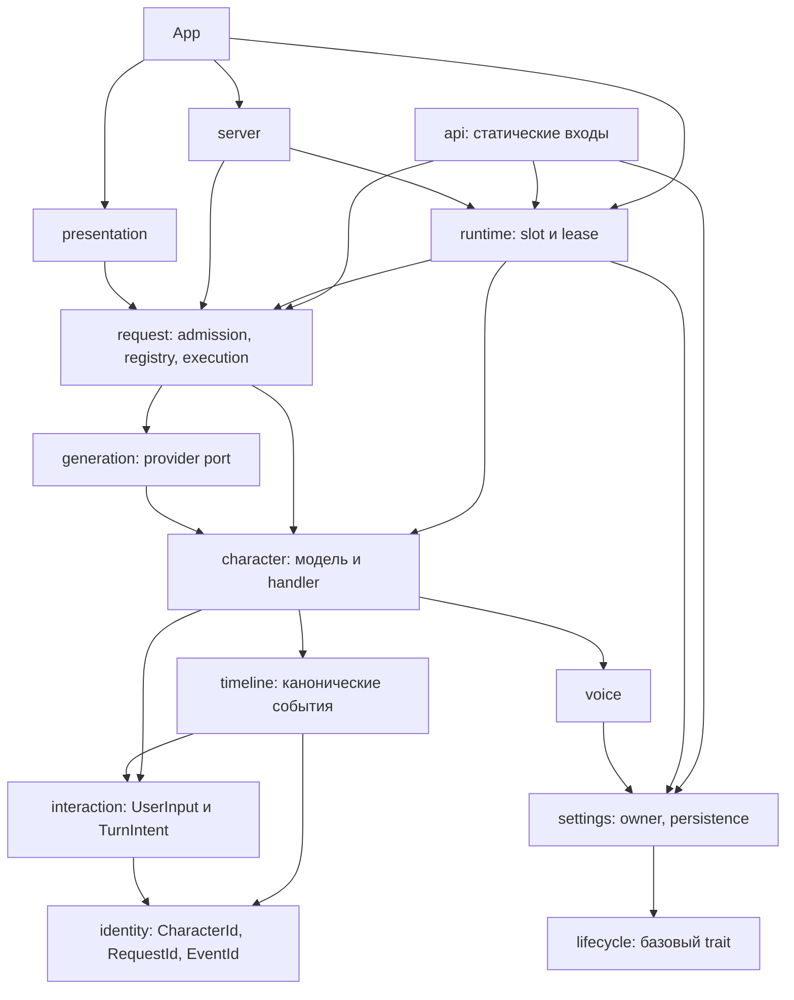

# Аудит направленности зависимостей Rust Core

Статус: **локальная экспериментальная ветка `audit/acyclic-dependencies`**. Срез исходников: `6718011` (`main` до документационных коммитов). Речь именно об импортных зависимостях верхнеуровневых модулей `src/`, а не об обязательном исполнении всех вызовов синхронно сверху вниз. Сопутствующая корневая карта на сервере: [root-primitives-and-client-contexts](https://github.com/Atm4x/neuromita-rust/blob/main/future/root-primitives-and-client-contexts.md).

## Результат

- Исходно **одна сильно связанная компонента из восьми модулей**: `api`, `character`, `generation`, `request`, `runtime`, `settings`, `timeline`, `voice`.
- После локального рефакторинга: **нет циклов между верхнеуровневыми исходными модулями**, включая учёт реэкспортов. Это проверено локальным построением графа по `use crate::...` и явным квалифицированным ссылкам `crate::...` в рабочих исходниках; скрипт аудита не встроен в production Cargo и не является формальной гарантией против будущих импортов.
- Публичные пути `character::CharacterId`, `request::RequestId`, `timeline::EventId`, `request::UserInput`, `request::TurnIntent`, `request::InputError`, `request::AcceptedResponse` и `settings::SettingsApi` сохранены.
- Существующие сценарные тесты выполняются на Rust 1.98.1, проверка Clippy `-D warnings` проходит; дополнительный `public_contract_paths` проверяет старые пути и сигнатуры.

## Граф компиляционных зависимостей

Стрелка `X -> Y` означает **X знает типы/методы Y**, а не `X` владеет состоянием `Y`.



Схема намеренно не показывает каждое транзитивное ребро, но показывает порядок и главное: **нет стрелок назад к узлу, который уже зависит от текущего**. Вся цепочка может быть топологически отсортирована. Адаптеры (Server/Presentation) используют свои нужные входы напрямую, не обязаны проходить через отдельный посредник ради красоты диаграммы.

## Что изменено и зачем

| Изменение | Устранённая инверсия | Смысл |
| --- | --- | --- |
| `identity.rs` | `timeline -> request -> timeline`, `timeline -> character -> timeline` | Типизированные ID — автономные immutable value types; *не* сервис, Handler или ещё один runtime |
| `interaction.rs` | `character -> request -> character` | UserInput, InputError, TurnIntent — данные взаимодействия, используемые обработчиком и записью событий; история не обязана импортировать очередь запросов |
| `request/admission.rs` | `runtime -> api -> runtime` | Внутренний объект приёма запросов принадлежит механизму исполнения; публичный статический API только делегирует |
| `character/handler.rs::AcceptedResponse` | `character -> request` | Результат применения принятого ответа определяет выполняющий его обработчик; `request` использует результат через совместимый экспорт |
| `api.rs::impl SettingsApi` | `settings -> runtime -> settings` | Значение/владелец настроек не знает глобальный runtime. Статическая точка входа объявлена в `settings`, но реализация доступа к общему runtime стоит в верхнем модуле `api` |
| `request`, `character`, `timeline` reexports | Нет изменения публичных путей | Публичные имена сохраняются, даже если каноническое определение нижнего типа переехало |

### Почему не добавлена четвёртая архитектурная роль

`identity` и `interaction` — **модули чистых значений**, не новые универсальные исполняемые примитивы. Никаких `Capability`, `ServiceLocator`, динамического реестра зависимостей, EventBus или общего `Context` не появилось. Роли `Api / Lifecycle / Handler` остались прежними; `RequestRegistry`, `ResponseGenerator` и `SessionTimeline` тоже остаются самостоятельными компонентами со своей конкретной ответственностью.

## Владение и выполнение НЕ изменены

```text
Unity / Sandbox / Python adapter
        |
        v
static ChatApi -> runtime slot -> request admission
                               |
                               v
                     RequestRegistry / MessageHandler[CharacterId]
                               |
                   +-----------+------------+
                   |                        |
                   v                        v
           CharacterHandle           ResponseGenerator
                   |                        |
                   v                        v
           CharacterHandler           GenerationProvider
                   |
                   v
         SessionTimeline + Character state
```

Персонаж по-прежнему имеет единственного владельца `CharacterHandler`, очередь `MessageHandler` по персонажу не изменена, а SessionTimeline остаётся совместно доступным объектом под Mutex. Ничего в этом аудите не превращает его в дополнительный Actor, и не вводится новая зависимость от контекста Unity/Sandbox.

## Инварианты для последующих изменений

1. Низовые типы идентичности и нормализованного ввода **не импортируют** `request`, `character`, `api`, `runtime` или presentation.
2. `timeline` не импортирует `request`/`character` ради ID; он хранит события с собственной семантикой и использует `interaction` и `identity`.
3. `character` не знает очередей, регистрации и RequestRecord; его Handler принимает нормализованный ввод, намерение и идентичность работы, отдаёт свой результат.
4. `generation` не вызывает статический ChatApi и не владеет персонажами; в частности, не импортирует `request` или `runtime`.
5. `request` имеет право координировать `character` и `generation`, но ни один из них не должен вызывать `request` обратно.
6. `runtime` связывает минимальные используемые состояния, а не импортирует публичный `api`, и не становится контейнером произвольных операций.
7. `settings` не зависит от `runtime`; `SettingsApi` остаётся публично доступным по прежнему пути. Базовый trait `Lifecycle` не должен знать конкретных модулей.
8. Клиенты и presenters могут использовать нижние typed handles, но не вводят обратные ссылки на собственные модули в domain/core.

## Что ещё НЕ подтверждено

- Граф проверен по import path в исходниках, но **не закреплён компилятором межcrate-границами**: модули остаются в одном Cargo crate. При необходимости можно добавить автоматическую структурную проверку, но она не должна вводить новый build-time runtime или ломать offline-сборку.
- Не было полного сравнения ABI, производительности, размера binary или производительного поведения будущих AI-воркеров: рефакторинг переносит объявления/методы без смены сигнатур и алгоритмов, но бенчмарки отдельно не выполнялись.
- Полноценный Sandbox-мессенджер, Unity-контекст и MitaView остаются предметом их собственных архитектурных контрактов; этот рефакторинг не претендует на их реализацию.
- `voice -> settings::Volume` остаётся **ацикличной, но предметно спорной** связью: выводить ли громкость в отдельный voice value type стоит рассматривать только вместе с требуемой совместимостью ошибок и API, не ради формального сокращения импортов.
