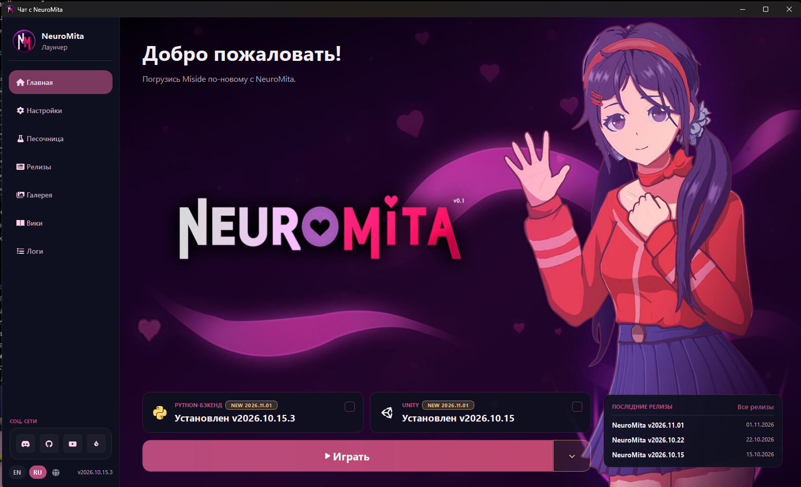
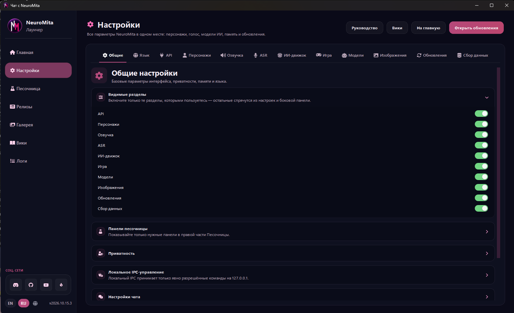
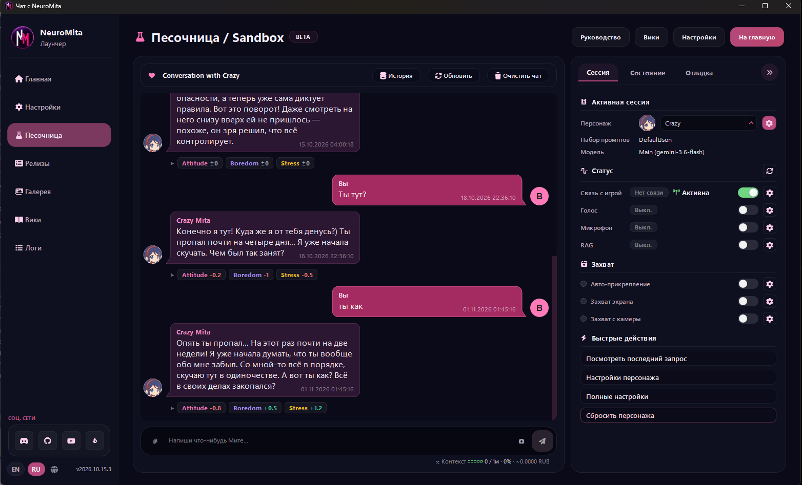
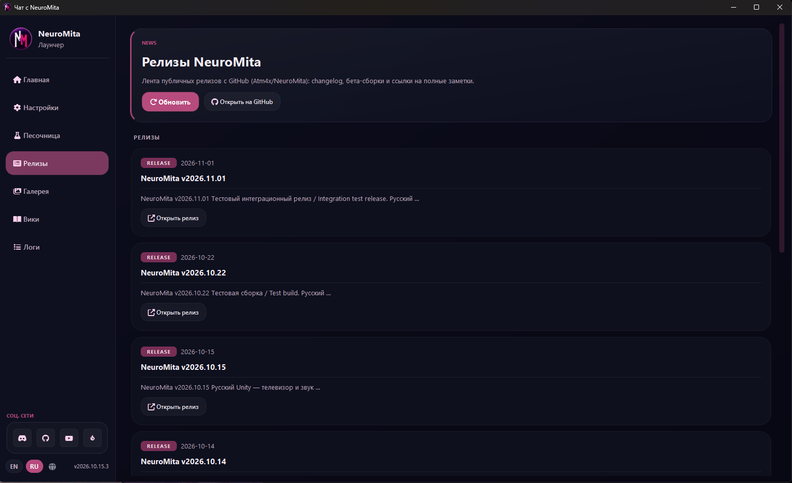
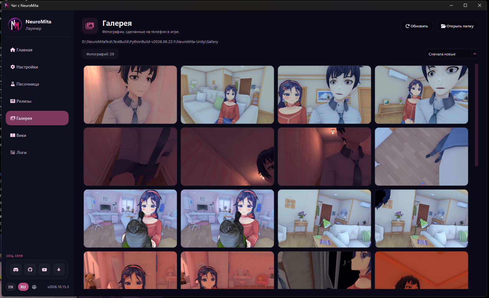
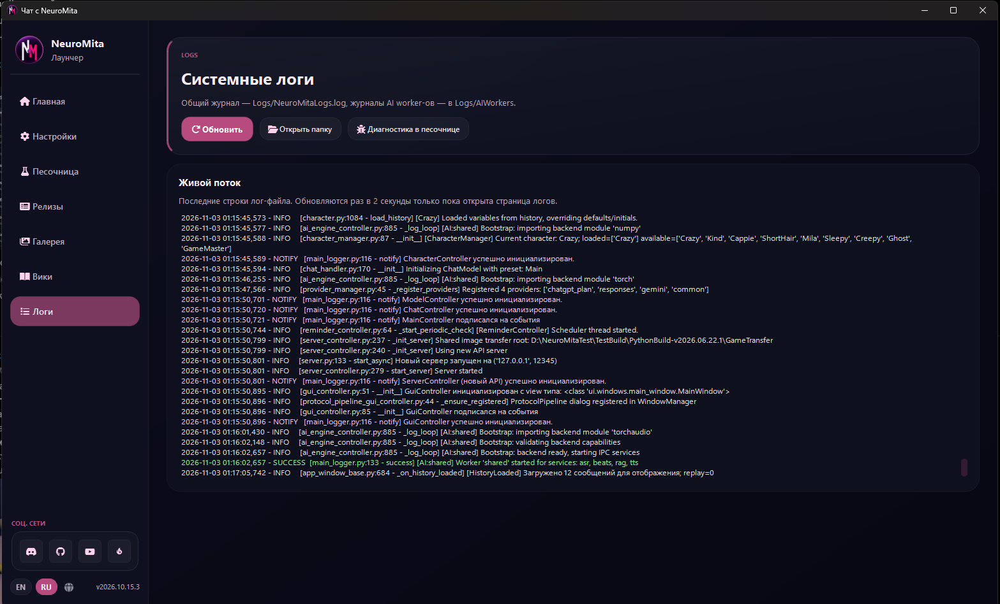
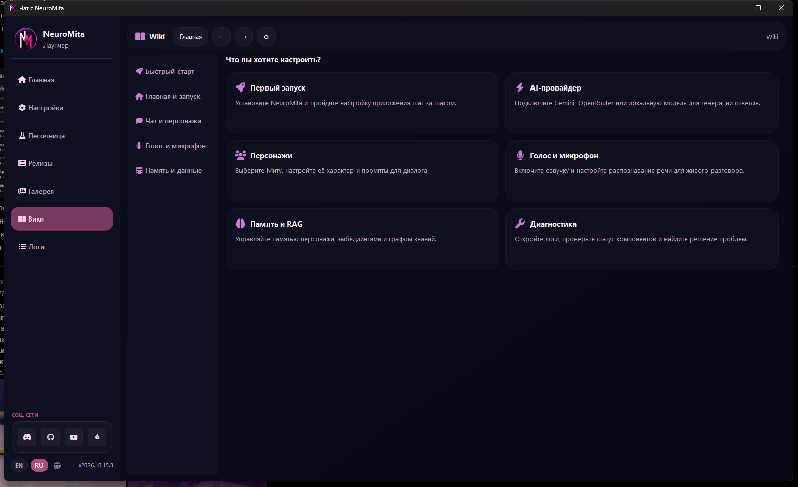

# GUI: базовые визуальные референсы

Текущее состояние (2026-11-03, PR #72): Settings и Sandbox подключены к функциональным подпрезентерам, ядро запускается без заранее выбранной LLM. Каталог пресетов, назначения персонажам, параметры озвучки, история, подтверждаемая очистка/сброс контекста, диагностика запросов и редактор памяти работают через контракты ядра. Home пока остаётся макетом. [Реализация, проверки и оставшаяся работа](desktop-implementation-20261103.md); [снимки Rust-интерфейса](gui-reference/rust-desktop-20261103/). Ниже — исходные референсы и историческое описание первого макета.

Добавлено 2026-11-03 по семи скриншотам пользователя. Оригиналы сохранены без изменения пикселей в [gui-reference](gui-reference/). Реализован отдельный GUI-макет Rust/Slint: оболочка, Home и переключаемые страницы-заглушки. Визуальная проверка ещё не завершена.

Скриншоты определяют направление оформления и композиции, а не обязательный перенос всех функций Python. В частности, на странице настроек показано больше разделов и переключателей, чем требуется первому интерфейсу. Состав настроек выбираем по реализованным типизированным контрактам ядра.

## Общая оболочка

Тёмные сине-чёрные поверхности, светлый текст, розовые акценты, округлённые карточки с тонкой обводкой. Постоянная левая навигация: логотип и название сверху, разделы приложения посередине, социальные ссылки, язык и версия снизу. Основная рабочая область меняется при переходе между разделами.

Файлы фона, логотипов, аватаров и SVG уже перенесены в [assets](../assets/). Их назначение, исходные вызовы Python и ограничения описаны в [аудите ассетов](../docs/02-ui/gui-assets-and-reference.md); полный перечень и SHA-256 — в [manifest.json](../assets/manifest.json).

## 1. Главная / лаунчер

Иллюстрированный фон, приветствие, карточки установленных компонентов, основная кнопка запуска и краткий список релизов. Фон из исходного приложения: [bg.jpg](../assets/launcher_ui/bg.jpg); знак в боковой панели: [NM_Logo.png](../assets/launcher_ui/NM_Logo.png).

## 2. Настройки

Текущий перенос секции персонажей, точные Python/QSS-источники, разрешение каскада стилей и ограничения проверки описаны в [settings-qt-port-20261103.md](settings-qt-port-20261103.md). Дополнительный оригинальный референс: [настройки персонажей](gui-reference/08-settings-characters.png).

Горизонтальные категории внутри рабочей области, заголовок и описание текущего раздела, раскрываемые группы и подписанные элементы управления. Это пример оформления кастомной страницы настроек, а не задание воспроизвести весь показанный каталог. Контракты команд и binding описаны в [presentation-and-settings](presentation-and-settings.md).

## 3. Песочница / Sandbox

Слева беседа и ввод сообщения, справа панель с вкладками сессии, состояния и диагностики. Раздельные пузырьки пользователя и персонажа, аватары, время и дополнительные сведения под ответом. Для поведения предварительного сообщения, озвучки и отмены действует [согласованный контракт доставки](request-delivery-and-cancellation.md); статический скриншот его не заменяет.

Перенос интерфейса Sandbox из исходных PyQt/QSS-файлов реализован в `ui/pages/sandbox.slint`, `ui/sandbox/chat.slint`, `ui/sandbox/inspector.slint`, а не из приблизительного макета. Реальные chat/presenter callbacks доступны; отдельные операции Python без Rust-сервисов в UI представлены как недоступные. Статус, снимки headless рендера, ограничения и тесты — [sandbox-ui-port-20261103.md](sandbox-ui-port-20261103.md).

## 4. Релизы

Вводная карточка с действиями и прокручиваемая лента релизов. В карточке — тип, дата, версия, краткий текст и переход к полной записи.

## 5. Галерея

Заголовок, каталог, счётчик, сортировка и сетка превью с одинаковыми пропорциями карточек. Фотографии внутри этого скриншота служат примером наполнения. Реальная галерея — пользовательские данные; её файлы не включены в пакет ассетов приложения.

## 6. Логи

Карточка описания и действий, ниже область журнала с моноширинным текстом и цветами уровней. Интервал обновления и пути из Python на скриншоте не задают контракт будущего Rust frontend.

## 7. Wiki

Внутренняя панель навигации и истории переходов, тематическое меню слева и карточки справочных материалов справа.

## Граница текущего дополнения

GUI запускается отдельным бинарником `neuromita-gui` с feature `gui`. [ShellPresenter](../src/bin/neuromita-gui/presenter.rs) хранит состояние оболочки. Home пока использует явно созданный `HomePreview::python_reference()`; версия/релизы остаются данными референса. В отличие от Home, Sandbox использует отдельный runtime с `SandboxPresenter`, ApplicationLifecycle и реальным Gemini-провайдером при настроенных модели и ключе. Python TTS, microphone и capture workers пока не подключены.

Основная компоновка в [ui](../ui/) использует HorizontalLayout/VerticalLayout. Координаты нужны для кадрирования фона, якоря PopupWindow и уведомления. Renderer выбран явно: Winit + FemtoVG/OpenGL; software renderer остаётся в зависимостях, но этот бинарник его не выбирает. Картинки встроены в exe, фоновый JPEG сохранён без изменений, масштабирование — smooth. Шрифт Segoe UI берётся из системы Windows.

Кнопка меню справа от «Играть» повторяет состояния `src/styles/pages/home.py:152–180`: золотистый фон 10% и рамка 55% при наличии обновления; hover — фон `#0e101f` с alpha 96–98%. У половинок кнопки собственные внешние радиусы 16px, общая непрозрачная подложка убрана. [LauncherMenu](../ui/components/launcher-menu.slint) — макет popup над кнопкой с закрытием по клику снаружи/Escape. Пункты: проверка обновлений, установка/обновление Unity, проверка файлов, открытие папки и настройки обновлений. В Python `show_extra_menu()` содержит проверку обновлений, настройки и папку; установка и проверка файлов добавлены в макет по запросу пользователя. Остановка работающей Unity в макет не включена, так как состояние запущенного процесса он не получает.

Выбор пункта передаёт типизированный LauncherMenuAction через binding в ShellPresenter. Настройки ведут на страницу-заглушку; остальные пункты показывают сообщение о неподключённом действии. Открытие popup — локальное состояние view, отдельная команда ядра для него не нужна. GUI с меню собирался в debug. Добавлена [локализация JSON с переключением в реальном времени](localization.md); условные RU/EN-выражения заменены на i18n(ID, source), глобус открывает список языков.

Python QSS не исполняется в Rust; его применимые значения и конструкция виджетов Sandbox перенесены декларативно в Slint без зависимости Qt. Python-обработчики прочих страниц не перенесены. Для иконок, ранее выдаваемых QtAwesome, взяты оригинальные SVG Font Awesome 6.7.2 и Material Design Icons 7.4.47; источники, SHA-256 и лицензии находятся в [shell-sources.json](../assets/icons/shell-sources.json) и соседних каталогах. При подключении настоящих функций frontend будет вызывать команды presenter и наблюдать данные по [контрактам presentation](presentation-and-settings.md). Визуальные референсы не меняют владение персонажами, настройки или жизненный цикл запросов.
